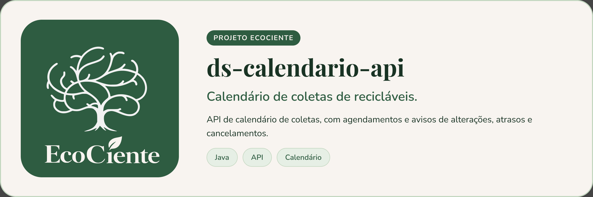

<p align="center">
  
</p>

# ds-calendario-api


API responsável por gerenciar o calendário de coletas de materiais recicláveis.

A aplicação permite:

* Consultar datas e horários das coletas por região;
* Gerenciar agendamentos recorrentes e avulsos;
* Informar alterações, atrasos e cancelamentos;
* Fornecer dados para integração com outros serviços do sistema.

## Executando no Visual Studio Code

Abra a pasta do projeto no Visual Studio Code.

A pasta aberta deve conter arquivos como:

```text
build.gradle
settings.gradle
gradlew
gradlew.bat
src
```

Em seguida, abra o terminal integrado do VS Code:

```text
Ctrl + `
```

Certifique-se de que o terminal está utilizando o **PowerShell** e execute:

```powershell
.\gradlew.bat clean bootRun --no-daemon
```

Quando a aplicação iniciar corretamente, será apresentada no terminal uma mensagem semelhante a:

```text
Started CalendarioApplication
```

## Verificando a versão do Java

Antes de executar o projeto, verifique a versão instalada:

```powershell
java -version
```

Este projeto deve ser executado com a versão do Java definida no arquivo `build.gradle`.

Caso a versão exibida seja diferente, configure o JDK correto no Visual Studio Code.

## Erro ao apagar a pasta `build`

Durante a compilação, pode ocorrer o seguinte erro:

```text
Execution failed for task ':compileJava'.

Unable to delete directory:
build\classes\java\main
```

Esse erro normalmente acontece quando algum processo Java ou Gradle ainda está utilizando os arquivos da pasta `build`.

Primeiro, interrompa qualquer execução anterior da aplicação pressionando:

```text
Ctrl + C
```

Depois, execute os comandos abaixo no terminal PowerShell.

### 1. Parar os processos do Gradle

```powershell
.\gradlew.bat --stop
```

### 2. Encerrar processos Java em execução

```powershell
Get-Process java,javaw -ErrorAction SilentlyContinue | Stop-Process -Force
```

> **Atenção:** esse comando encerra todos os processos Java em execução no computador, incluindo outras aplicações Java que estejam abertas.

### 3. Remover a pasta de compilação

```powershell
Remove-Item -Recurse -Force .\build -ErrorAction SilentlyContinue
```

### 4. Remover o cache local do Gradle

```powershell
Remove-Item -Recurse -Force .\.gradle -ErrorAction SilentlyContinue
```

### 5. Confirmar a versão do Java

```powershell
java -version
```

### 6. Executar novamente a aplicação

```powershell
.\gradlew.bat clean bootRun --no-daemon
```

## Sequência completa para corrigir o erro

Caso seja necessário realizar toda a limpeza, execute:

```powershell
.\gradlew.bat --stop

Get-Process java,javaw -ErrorAction SilentlyContinue | Stop-Process -Force

Remove-Item -Recurse -Force .\build -ErrorAction SilentlyContinue

Remove-Item -Recurse -Force .\.gradle -ErrorAction SilentlyContinue

java -version

.\gradlew.bat clean bootRun --no-daemon
```

Caso o problema continue, feche o Visual Studio Code, reinicie o computador, abra novamente a pasta do projeto e execute:

```powershell
.\gradlew.bat clean bootRun --no-daemon
```

## Contribuindo

Leia o [CONTRIBUTING.md](CONTRIBUTING.md) antes de abrir uma Pull Request. Ao participar, você concorda com o [Código de Conduta](CODE_OF_CONDUCT.md).

## Segurança

Encontrou uma vulnerabilidade? Siga o [SECURITY.md](SECURITY.md). **Não abra issue pública.**

## Licença

Este projeto está sob a licença MIT. Veja o arquivo [LICENSE](LICENSE).
